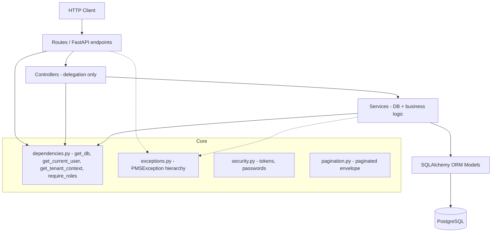
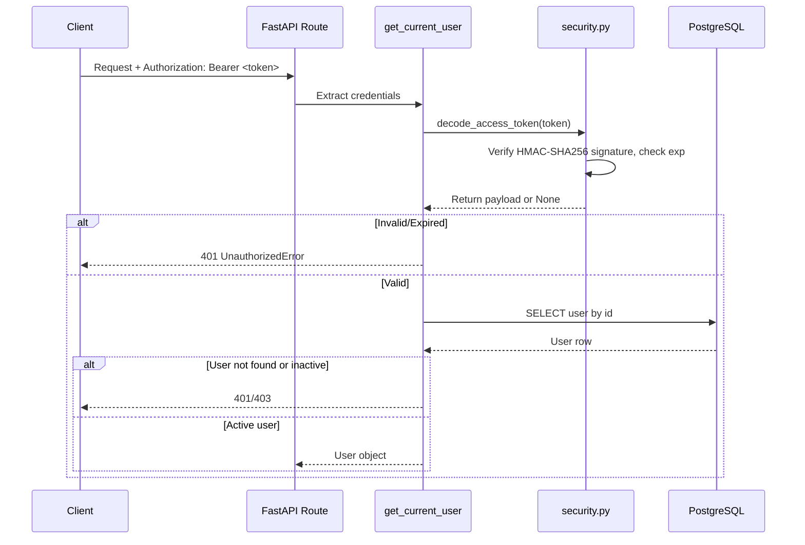
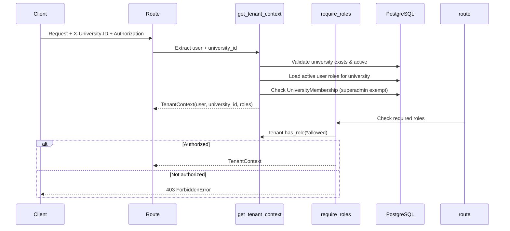
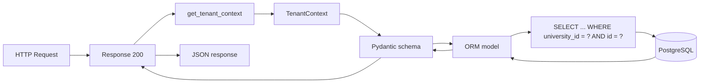

# PMS System Architecture

## 1. Architecture Overview

PMS (Project Management System) is a **backend-only** REST API for managing university research activities. The system follows a clean layered architecture with strict separation between HTTP handling, orchestration, business logic, and data access.

**Key characteristics:**
- **Backend-only**: No frontend application exists in the repository.
- **Multi-tenant**: Each deployment serves one university at a time; every domain resource is scoped to a `university_id`.
- **Layered**: Routes → Controllers → Services → Models.
- **Database-first integrity**: PostgreSQL check constraints, composite foreign keys, and unique constraints enforce business rules at the storage layer.

## 2. Technology Stack

| Layer | Technology | Version | Purpose |
|-------|-----------|---------|---------|
| Web framework | FastAPI | `>=0.115,<1` | Routing, request validation, OpenAPI |
| ASGI server | uvicorn | `>=0.30,<1` | Production/ development server |
| ORM | SQLAlchemy | `>=2.0,<3` | Database abstraction, declarative models |
| DB driver | psycopg | `>=3.2,<4` | PostgreSQL driver |
| Migrations | Alembic | `>=1.13,<2` | Schema versioning |
| Settings | pydantic-settings | `>=2.0,<3` | Environment-based configuration |
| Validation | Pydantic v2 | — | Request/response schemas |
| Testing | pytest + FastAPI TestClient | — | API and database tests |
| Auth | Custom HMAC-SHA256 | — | Token signing/verification (stdlib only) |
| Password hashing | PBKDF2-HMAC-SHA256 | — | `hashlib` + `secrets` (stdlib only) |

See `backend/requirements.txt`.

## 3. Frontend Architecture

**Not implemented.** The repository contains no frontend code. PMS is a backend-only API. API consumers interact via HTTP/JSON against `/api/v1`. OpenAPI documentation is auto-generated by FastAPI.

## 4. Backend Architecture

### Entry Point

`backend/app/main.py`:
- Creates the FastAPI application instance.
- Registers global exception handlers via `register_exception_handlers(app)`.
- Includes the aggregated `api_router` (prefix `/api/v1`).
- Exposes `GET /health` returning `{"status": "ok"}`.

### Router Aggregation

`backend/app/routes/api.py` imports and mounts 37 routers across 12 domains under the `/api/v1` prefix:

| Group | Routers |
|-------|---------|
| Users & Auth | auth, users, roles, user_roles |
| Universities & Settings | universities, memberships, settings |
| Organization | faculties, departments, leadership, staff, students |
| Research Topics | topics, duplicates |
| Research Proposals | proposals |
| Research Projects | projects, templates, milestones |
| Progress Reports & Activity | reports, comments, activity |
| Grants | opportunities, applications, awards, expenditures, reports |
| Publications | publications |
| Approvals | workflows, instances |
| Notifications & Alerts | notifications, preferences, alert_rules, alert_events |
| Files, Audit & Retention | stored_files, attachments, audit_logs, retention_policies |

### Layer Diagram



### Layer Responsibilities

| Layer | Files | Responsibilities | DB Access? |
|-------|-------|-----------------|------------|
| Routes | `backend/app/routes/*.py` | HTTP method/status, query params, dependency injection, response modeling | No |
| Controllers | `backend/app/controller/*.py` | Delegate to services, serialize ORM → Pydantic schemas | No |
| Services | `backend/app/services/*.py` | All DB queries, transactions, FK validation, duplicate prevention, tenant isolation, business rules | Yes |
| Models | `backend/app/models/*.py` | Table definitions, constraints, relationships | No (ORM mapping) |
| Core | `backend/app/core/*.py` | Config, dependencies, exceptions, pagination, security | Via `get_db` |

## 5. Database Architecture

### Primary Key Strategy

- **Integer PKs** (7 tables): `users`, `roles`, `user_roles`, `faculties`, `departments`, `student_profiles`, `staff_profiles`.
- **UUID PKs** (53 tables): All other tables, default `uuid.uuid4`.

### Tenant Isolation at the Storage Layer

Every domain table carries a `university_id` column. Cross-table foreign keys are **composite**: `(column, university_id)` references `(referenced_column, university_id)`. This prevents a row in university A from referencing a row in university B.

Example from `research_proposals`:
```sql
FOREIGN KEY (topic_id, university_id) REFERENCES research_topics(id, university_id)
FOREIGN KEY (department_id, university_id) REFERENCES departments(id, university_id)
FOREIGN KEY (submitting_user_id, university_id) REFERENCES university_memberships(user_id, university_id)
UNIQUE (id, university_id)
```

### Timestamps

`TimestampMixin` (in `base.py`) provides:
- `created_at`: `DateTime(timezone=True)`, server default `now()`.
- `updated_at`: `DateTime(timezone=True)`, server default `now()`, `onupdate=now()`.

All timestamps are timezone-aware.

### Constraints

PostgreSQL check constraints enforce domain rules directly in the database:
- Status enums (e.g., proposals: draft/submitted/under_review/revision_requested/approved/rejected/withdrawn)
- Amount non-negativity
- Date ordering (end >= start)
- Single active lead per proposal/project (partial unique indexes)

### Migrations

- Tool: Alembic
- Configuration: `alembic.ini`
- Environment: `alembic/env.py` (reads `DATABASE_URL` from settings, targets `Base.metadata`)
- Current head: `b1c2d3e4f5a6`
- 6 migration revisions exist in `alembic/versions/`

### Schema Diagram Source

`docs/pms_schema.dbml` — DBML source file generated from `Base.metadata`, containing all 60 tables and foreign key relationships. Note: DBML cannot represent PostgreSQL triggers, ORM event guards, partial-index predicates, or migration history.

## 6. API Architecture

### Base Path

All API routes are mounted under `/api/v1`.

### Standard Endpoint Patterns

| Method | Path | Status | Description |
|--------|------|--------|-------------|
| POST | `/` | 201 | Create resource |
| GET | `/` | 200 | List resources (paginated) |
| GET | `/{id}` | 200 / 404 | Get single resource |
| PATCH/PUT | `/{id}` | 200 | Update resource |
| DELETE | `/{id}` | 200 | Delete resource |
| POST | `/{id}/action` | 200 | Domain action (e.g., `/submit`, `/status`) |

### Response Shapes

- **Single object**: Entity read schema (Pydantic model validated from ORM).
- **List**: `PaginatedResponse[T]` — `{ items, total, page, page_size, total_pages }`.
- **Delete success**: `{ "status": "success", "message": "..." }`.

### Error Response Shape

All errors return JSON:
```json
{ "detail": "...", "error_code": "...", "error": "<ExceptionClassName>" }
```

### Status Codes

| Code | Meaning |
|------|---------|
| 200 | Success (GET, PUT, PATCH, DELETE) |
| 201 | Created (POST) |
| 400 | Bad request, invalid input, FK violation, check constraint |
| 401 | Unauthorized (missing/invalid token) |
| 403 | Forbidden (insufficient role, inactive account, inactive tenant, cross-tenant membership) |
| 404 | Not found (including cross-tenant — existence not leaked) |
| 409 | Duplicate resource / unique constraint violation |
| 422 | Validation error (Pydantic schema) |

### Route Ordering Rule

Static routes must be declared **before** dynamic parameterized routes on the same router to avoid path shadowing (e.g., `/permissions` before `/{role_id}`).

## 7. Authentication Architecture

### Token Format

Custom JWT-compatible tokens using HMAC-SHA256 (not PyJWT):
- Header: `{"alg": "HS256", "typ": "JWT"}`
- Payload: includes `sub` (user ID), `email`, `iat`, `exp`
- Signature: HMAC-SHA256 using `SECRET_KEY`
- Expiry: 24 hours (configurable via `TOKEN_EXPIRY_SECONDS`)

### Authentication Flow



### Password Hashing

- Algorithm: PBKDF2-HMAC-SHA256
- Iterations: 100,000
- Salt: 16 bytes random (`secrets.token_hex(16)`)
- Format: `pbkdf2:sha256:<iterations>$<salt>$<derived_hex>`

### Authentication Sources

`get_current_user` supports two sources (checked in order):
1. `Authorization: Bearer <token>` header
2. `X-User-Id` header (fallback)

## 8. Authorization Architecture

### Role Model

- `roles` table: `id` (int), `code` (unique), `name` (unique), `description`, `is_active`.
- `user_roles` table: assigns a role to a user within a university (composite FK to `university_memberships`).
- `permissions` table: `id` (uuid), `code` (unique), `description`, `is_active`.
- `role_permissions` junction table: links roles to permissions.

### Seeded Role Codes

From `backend/app/models/seed.py` (`INITIAL_ROLE_CODES`):
- `student`
- `supervisor`
- `department_head`
- `research_admin`
- `grant_admin`
- `university_admin`
- `superadmin`

Note: `superadmin` is seeded as reference data only — seeding grants it to no one; it must be manually assigned for the bypass in `dependencies.py` to take effect.

### Authorization Flow



### Role-Based Access Summary

| Route Group | Required Role | Self-Access? |
|-------------|--------------|--------------|
| `GET /users` (list) | `university_admin` | N/A |
| `GET/PATCH /users/{id}` | None (self) or `university_admin` (other) | Yes |
| `DELETE /users/{id}` | `university_admin` | No |
| `POST/GET/PUT/DELETE /roles` | `university_admin` | N/A |
| `POST/GET /permissions` | `university_admin` | N/A |
| `POST/DELETE /roles/permissions/...` | `university_admin` | N/A |
| University-scoped domain routes | Active membership | N/A |

## 9. Multi-Tenancy Architecture

### Tenant Context

`TenantContext` (dataclass in `dependencies.py`):
- `user`: The authenticated `User` object.
- `university_id`: UUID of the active university.
- `roles`: List of active role codes for this university.
- `has_role(*codes)`: Returns True if user has any listed role or is `superadmin`.

### Tenant Resolution (`get_tenant_context`)

1. Requires `X-University-ID` header (or `university_id` query param).
2. Validates the UUID format.
3. Checks university exists and is active (404 / 403 otherwise).
4. Loads active role codes for the user in that university.
5. Checks for global `superadmin` (bypasses membership check).
6. Verifies active `UniversityMembership` (superadmin exempt).
7. Returns `TenantContext`.

### Tenant Enforcement at Service Layer

Every service method receives `university_id` and filters all queries by it:
```python
query = select(Model).where(Model.university_id == university_id)
```

Cross-tenant resource access returns **404** (not 403) to avoid leaking resource existence.

### Composite FK Enforcement

All cross-table foreign keys include `university_id`, enforced by PostgreSQL RESTRICT constraints.

## 10. Application Layers

### Routes Layer

- Parse HTTP requests and extract query/path parameters.
- Inject dependencies: `get_db`, `get_current_user`, `get_tenant_context`, `require_roles`.
- Call controller methods and return responses.
- No database queries.

### Controller Layer

- Receive `db: Session`, `tenant: TenantContext`, and request data.
- Delegate to the appropriate service.
- Serialize ORM models to Pydantic read schemas via `model_validate()`.
- **No database queries.**

### Service Layer

- Own all database access and business logic.
- Perform FK/relationship validation, duplicate prevention, tenant isolation.
- Manage transactions: `db.flush()` for IDs, single `db.commit()` per operation.
- Raise `PMSException` subclasses for business rule violations.

### Model Layer

- SQLAlchemy 2.0 declarative models.
- Table constraints (check, unique, foreign key).
- Relationship definitions with `passive_deletes=True` where appropriate.

### Core Layer

- `config.py`: `Settings` (pydantic BaseSettings, loads `.env`).
- `dependencies.py`: `get_db`, `get_current_user`, `get_tenant_context`, `require_roles`, `TenantContext`.
- `exceptions.py`: `PMSException` hierarchy + FastAPI exception handlers.
- `pagination.py`: `PaginationParams`, `PaginatedResponse`, `paginate()`.
- `security.py`: Password hashing, token creation/verification.

### Database Layer

- `session.py`: SQLAlchemy engine, `SessionLocal`, `get_db()` generator.

## 11. Data Flow

### Typical Read Request (GET /api/v1/research-proposals/{id})



### Typical Write Request (POST /api/v1/research-proposals)

```mermaid
graph LR
    Req[HTTP Request + Body] --> Route[Route: create_proposal]
    Route --> Dep[get_tenant_context]
    Dep --> CTX[TenantContext]
    CTX --> Ctrl[Controller: create_proposal]
    Ctrl --> Svc[Service: create_proposal]
    Svc --> Val[Validate FKs: topic, department, membership]
    Val --> Flush[db.flush() - get proposal ID]
    Flush --> Hist[Create status history]
    Hist --> Commit[db.commit() - single transaction]
    Commit --> DB[(PostgreSQL)]
    DB --> Svc[Refresh ORM model]
    Svc --> Ctrl[Pydantic schema]
    Ctrl --> Route[Response 201]
    Route --> Client[JSON response]
```

## 12. Important Workflows

### Research Proposal Lifecycle

```
Create (draft) → Submit (submitted) → Review (under_review/revision_requested)
     ↓                                          ↓
Approve (approved) ←────────────────── Reject (rejected)
     ↓
Create Project (one per proposal)
```

### Research Project Lifecycle

```
Create from approved proposal (active)
     → Add milestones → Add participants/supervisors
     → Submit progress reports
     → Transition status (completed/cancelled/archived)
```

### Grant Lifecycle

```
Create opportunity (draft/open)
     → Submit application (draft → submitted)
     → Review application
     → Issue award (application → approved)
     → Record expenditures
     → Submit progress reports against award
```

### Publication Lifecycle

```
Submit (draft) → Submit for verification (submitted)
     → Under verification → Verified / Rejected / Withdrawn
     → Link to project
```

### User Onboarding

```
Register → Verify email → Create membership → Assign roles
```

Detailed workflow documentation: [`docs/product/WORKFLOWS.md`](WORKFLOWS.md).

## 13. External Integrations

PMS does **not** integrate with external services in the current implementation:

| Integration | Status | Notes |
|-------------|--------|-------|
| Email/SMS delivery | Not implemented | Notification preferences stored but no delivery provider |
| File storage | Not implemented | `stored_files.storage_key` references external storage not managed by PMS |
| OAuth/SSO | Not implemented | Custom token auth only |
| Calendar/scheduling | Not implemented | |
| Payment processing | Not implemented | |

## 14. Architectural Decisions

| Decision | Rationale |
|----------|-----------|
| Layered architecture (Routes → Controllers → Services → Models) | Separation of concerns; controllers contain no DB queries, making them easy to test and reason about |
| Single transaction per service operation (`flush()` + one `commit()`) | Prevents orphaned rows on partial failure |
| Composite FKs `(id, university_id)` | Enforces tenant isolation at the database level, not just application level |
| 404 for cross-tenant access | Avoids leaking resource existence to unauthorized tenants |
| Custom HMAC-SHA256 tokens (not PyJWT) | No extra dependency; stdlib-only implementation |
| Hard deletes (no soft delete) | Simplicity; some tables have `deleted_at` columns but services don't use them |
| RBAC on admin + domain mutation routes | Reads stay member-open; mutations gated by matching domain role |
| Paginated envelope on all list endpoints | Consistent API shape for clients |

## 15. Known Architectural Gaps

| Gap | Description | Impact |
|-----|-------------|--------|
| No frontend | Backend-only API | API consumers must build their own client |
| No notification delivery | Preferences stored but no email/SMS/push provider | Notifications are stored but not delivered |
| No scheduled jobs | Alert rules defined but no scheduler/evaluator | Alerts are not automatically generated |
| No soft deletion | Hard `db.delete()` used throughout (guarded by service-level checks) | Deleted data is not recoverable |

Previously listed and now resolved: domain-level RBAC (mutations gated by matching domain role), `superadmin` seeding (reference data, granted to no one), and delete guards (structured `SpecializedOperationError` across all domains).

## 16. Related Documents

- [`ARCHITECTURE_ESSENTIALS.md`](ARCHITECTURE_ESSENTIALS.md) — Concise reference
- [`DATABASE.md`](DATABASE.md) — Database schema reference
- [`API.md`](API.md) — API endpoint reference
- [`SECURITY.md`](SECURITY.md) — Security model
- [`AGENTS.md`](../AGENTS.md) — AI development instructions
- [`PRD.md`](../PRD.md) — Product requirements
- [`docs/pms_schema.dbml`](pms_schema.dbml) — DBML schema diagram
