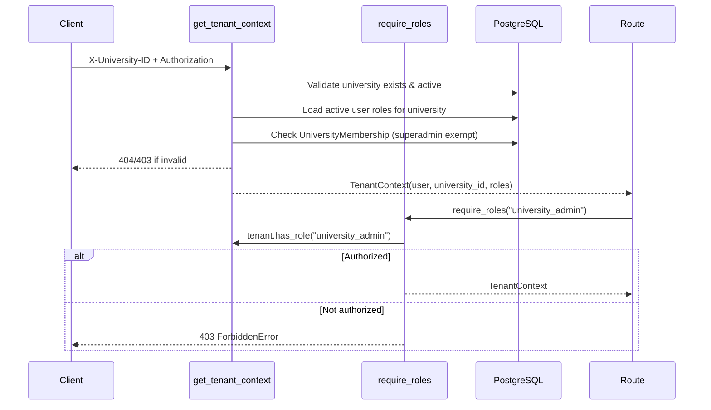

# PMS Security Reference

## Overview

PMS implements defense-in-depth security at the authentication, authorization, transport, and data layers. The system is a backend-only API with no frontend, so all security controls are enforced server-side.

## Authentication

### Token Scheme

- **Type**: Custom HMAC-SHA256 JWT-compatible tokens (not PyJWT).
- **Header**: `Authorization: Bearer <token>`.
- **Fallback**: `X-User-Id: <user_id>` header (for development/testing).
- **Payload**: `sub` (user ID), `email`, `iat` (issued at), `exp` (expiry).
- **Expiry**: 24 hours (`TOKEN_EXPIRY_SECONDS = 86400`).
- **Signature**: HMAC-SHA256 using `SECRET_KEY`.
- **Implementation**: `backend/app/core/security.py` — `create_access_token()`, `decode_access_token()`.

### Password Hashing

- **Algorithm**: PBKDF2-HMAC-SHA256.
- **Iterations**: 100,000.
- **Salt**: 16 bytes random (`secrets.token_hex(16)`).
- **Storage format**: `pbkdf2:sha256:<iterations>$<salt>$<derived_hex>`.
- **Verification**: Constant-time comparison via `hmac.compare_digest()`.
- **Implementation**: `security.hash_password()`, `security.verify_password()`.

### Authentication Flow (`get_current_user`)

1. Extract credentials from `Authorization: Bearer` header or `X-User-Id` header.
2. If Bearer token: decode and verify HMAC-SHA256 signature; check expiration.
3. If no valid token: try `X-User-Id` header.
4. If still no user ID: raise `UnauthorizedError` (401).
5. Look up user by ID in database.
6. If user not found: raise `UnauthorizedError` (401).
7. If user status is not `active`: raise `ForbiddenError` (403).
8. Return the `User` object.

### SECRET_KEY

- Source: `settings.secret_key` (from environment or `.env`).
- Default (insecure): `"pms-insecure-development-secret-key-replace-in-prod"`.
- **Production requirement**: Must be overridden via environment variable before deployment.

## Authorization

### Role Model

| Table | Purpose |
|-------|---------|
| `roles` | Role definitions (code, name, description, is_active) |
| `user_roles` | Assigns a role to a user within a university |
| `permissions` | Permission definitions (code, description, is_active) |
| `role_permissions` | Junction table linking roles to permissions |

### Seeded Role Codes (`INITIAL_ROLE_CODES`)

- `student`
- `supervisor`
- `department_head`
- `research_admin`
- `grant_admin`
- `university_admin`
- `superadmin`

Note: `superadmin` is seeded as reference data only — seeding grants it to no one. It must be manually assigned to a user for the bypass paths to activate.

### Authorization Flow (`get_tenant_context` + `require_roles`)



### Role-Based Access Summary

| Endpoint Group | Required Role | Self-Access |
|---------------|--------------|-------------|
| `GET /users` (list) | `university_admin` | N/A |
| `GET/PATCH /users/{id}` | None (self) / `university_admin` (other) | Yes |
| `DELETE /users/{id}` | `university_admin` | No |
| `POST/GET/PUT/DELETE /roles`, `/roles/permissions` | `university_admin` | N/A |
| `POST/POST revoke/DELETE /user-roles` | `university_admin` | N/A |
| `POST/GET/PUT/DELETE /universities` | `university_admin` | N/A |
| Memberships + settings mutations | `university_admin` | N/A |
| `POST/PATCH/PUT/DELETE /faculties` | `university_admin` | N/A |
| `POST/PATCH/PUT/DELETE /departments`, department leadership | `department_head` or `university_admin` | N/A |
| Research topics, duplicate-candidate review, approval workflows/versions/steps, audit logs, retention policies, milestone templates | `research_admin` or `university_admin` | N/A |
| Grant opportunities, awards, allocations, expenditures | `grant_admin` or `university_admin` | N/A |
| Collaborative research routes (proposals, projects, milestones, progress reports, publications, grant applications, files, notifications) and all reads | Active membership | Yes |

`superadmin` passes every `require_roles` gate. The full matrix is in [`USER_ROLES.md`](../product/USER_ROLES.md).

### Key Rules

- `superadmin` bypasses `require_roles` checks (`has_role()` returns True).
- `superadmin` still requires tenant context (`get_tenant_context`) for university-scoped operations.
- Cross-tenant resource access returns **404** (not 403) to avoid leaking existence.
- Role checks belong in routes via `require_roles`, not hardcoded in services.
- Reads stay open to all active members; only mutations on organizational/administrative routes are role-gated.
- Deleting an entity still referenced by user-created data returns **400** `SpecializedOperationError` (`RESTRICTED_OPERATION`) instead of leaking raw integrity errors.

## Multi-Tenancy Security

### Tenant Resolution

Every university-scoped endpoint requires `X-University-ID` header (or `university_id` query parameter). `get_tenant_context`:
1. Validates UUID format.
2. Checks university exists and is active.
3. Loads active role codes for the user in that university.
4. Checks for global `superadmin`.
5. Verifies active `UniversityMembership` (superadmin exempt).
6. Returns `TenantContext`.

### Service-Level Enforcement

Every service method receives `university_id` and filters all queries:
```python
query = select(Model).where(Model.university_id == university_id)
```

### Database-Level Enforcement

Composite foreign keys include `university_id`:
```sql
FOREIGN KEY (column, university_id)
  REFERENCES referenced_table(referenced_column, university_id)
  ON DELETE RESTRICT
```

This prevents cross-tenant orphan references at the storage layer.

## Exception Handling

### Exception Hierarchy (`core/exceptions.py`)

```
PMSException (base, HTTP 400)
├── NotFoundError (404, NOT_FOUND)
├── DuplicateResourceError (409, DUPLICATE_RESOURCE)
├── ForeignKeyViolationError (400, FOREIGN_KEY_VIOLATION)
├── InvalidInputError (400, INVALID_INPUT)
├── UnauthorizedError (401, UNAUTHORIZED)
├── ForbiddenError (403, FORBIDDEN)
├── DatabaseError (500, DATABASE_ERROR)
└── SpecializedOperationError (400, RESTRICTED_OPERATION; configurable status_code)
```

### Error Response Format

```json
{
  "detail": "Human-readable message",
  "error_code": "ERROR_CODE",
  "error": "ExceptionClassName"
}
```

### Handlers (registered in `main.py` via `register_exception_handlers`)

| Exception Type | Status Code | Behavior |
|---------------|-------------|----------|
| `PMSException` | As defined | Returns `detail`, `error_code`, `error` (class name) |
| `IntegrityError` (SQLSTATE 23505) | 409 | Unique violation → DUPLICATE_RESOURCE |
| `IntegrityError` (SQLSTATE 23503) | 400 | FK violation → FOREIGN_KEY_VIOLATION |
| `IntegrityError` (SQLSTATE 23514) | 400 | Check violation → CHECK_CONSTRAINT_VIOLATION |
| `IntegrityError` (SQLSTATE 23502) | 400 | Not-null violation → NOT_NULL_VIOLATION |
| `IntegrityError` (other) | 400 | INTEGRITY_ERROR |
| `SQLAlchemyError` | 500 | DATABASE_ERROR (no internals leaked) |
| `Exception` (unhandled) | 500 | INTERNAL_SERVER_ERROR (no internals leaked) |

### Rules

- Services raise `PMSException` subclasses; controllers/routes do not catch them.
- Never return raw database exceptions or stack traces to clients.
- Global handlers catch all exceptions at the FastAPI level.

## Data Protection

### Passwords

- Never stored in plaintext.
- PBKDF2-HMAC-SHA256 with 100,000 iterations and random salt.
- `verify_password()` uses constant-time comparison.

### Tokens

- Signed with HMAC-SHA256; tampering is detected.
- Expire after 24 hours.
- No refresh token mechanism implemented.

### Sensitive Fields

- `password_hash` is excluded from read schemas (`UserRead`).
- Audit logs store action metadata but not passwords or tokens.

## Input Validation

### Pydantic Schemas

- All request bodies validated via Pydantic v2 models.
- Status transitions use pattern validation:
  - `ProposalStatusTransition.new_status`: `^(draft\|submitted\|under_review\|revision_requested\|approved\|rejected\|withdrawn)$`
  - `ProjectStatusTransition.new_status`: `^(active\|on_hold\|completed\|cancelled\|archived)$`
- Invalid status returns 422 (Pydantic validation error) before reaching business logic.

### Database Check Constraints

PostgreSQL check constraints enforce domain rules as a second line of defense (see `DATABASE.md`).

## Known Security Considerations

| Item | Status | Notes |
|------|--------|-------|
| `SECRET_KEY` default | ⚠️ Insecure default | Must be changed in production via environment |
| Token algorithm | ✅ HMAC-SHA256 | Custom implementation, no PyJWT dependency |
| Password hashing | ✅ PBKDF2 100k iterations | Industry-standard work factor |
| Token expiry | ✅ 24 hours | Configurable |
| HTTPS enforcement | ❌ Not implemented | Must be enforced at the infrastructure/load balancer layer |
| Rate limiting | ❌ Not implemented | No rate limiting middleware |
| CORS configuration | ❌ Not implemented | No CORS middleware configured |
| Request size limits | ❌ Not implemented | No max body size configured |
| `superadmin` seeding | ✅ Seeded as reference data | Granted to no one; manual assignment required to activate |
| Domain-level RBAC | ✅ Implemented | Mutations on organizational/administrative routes gated by matching domain role |
| Delete guards | ✅ Implemented | Blocked deletes return 400 `RESTRICTED_OPERATION`; machine-derived rows cascade |
| Soft deletion | ❌ Not implemented | Hard deletes; deleted data not recoverable |
| Audit logging coverage | ⚠️ Partial | AuditLog model exists but service usage varies by domain |

## Security Checklist for Changes

- [ ] New endpoints use `get_tenant_context` for university-scoped operations.
- [ ] Admin endpoints use `require_roles("university_admin")` where appropriate.
- [ ] Domain mutations use `require_roles(...)` with the matching domain role.
- [ ] New delete operations guard against dependent data (`SpecializedOperationError`).
- [ ] Self-access to user profiles is preserved.
- [ ] Cross-tenant access returns 404, not 403.
- [ ] Services filter all queries by `tenant.university_id`.
- [ ] No raw database exceptions are returned to clients.
- [ ] Pydantic schemas validate input before business logic.
- [ ] `SECRET_KEY` is not hardcoded in new code.

## Related Documents

- [`AGENTS.md`](../AGENTS.md) — Authentication and authorization rules, security requirements
- [`ARCHITECTURE.md`](ARCHITECTURE.md) — Authentication and authorization architecture
- [`ARCHITECTURE_ESSENTIALS.md`](ARCHITECTURE_ESSENTIALS.md) — Auth principles
- [`PRD.md`](../PRD.md) — Security-related product requirements
