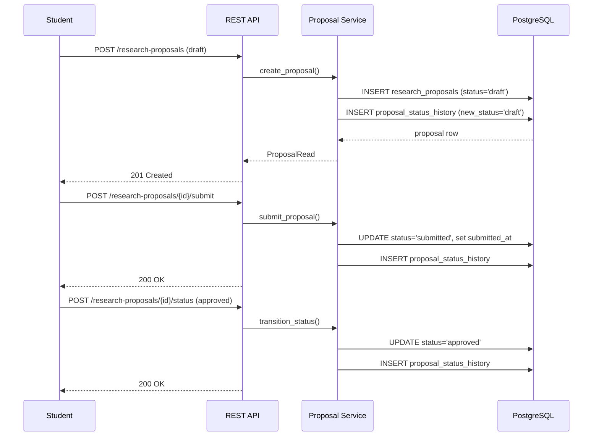
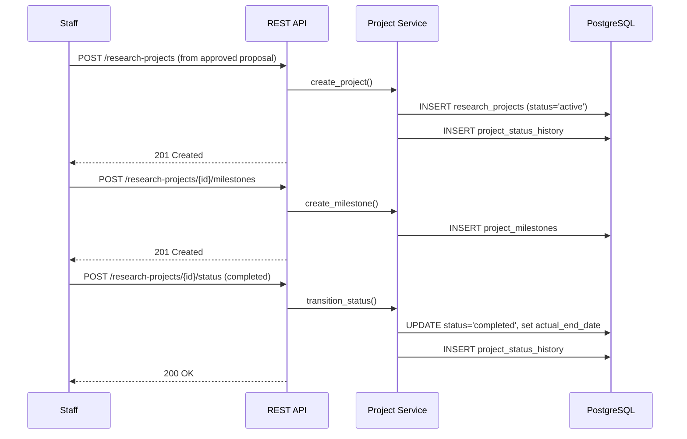

# PMS Workflows

## Overview

This document describes the key business workflows in PMS. Each workflow shows the states, transitions, and actors involved.

## 1. Research Proposal Lifecycle

### States

| State | Description |
|-------|-------------|
| `draft` | Initial state; proposal can be edited or deleted |
| `submitted` | Proposal submitted for review; `submitted_at` is set |
| `under_review` | Proposal is under review |
| `revision_requested` | Reviewer requested revisions; proposal can be edited again |
| `approved` | Proposal approved; eligible for project creation |
| `rejected` | Proposal rejected |
| `withdrawn` | Proposal withdrawn |

### Transitions

```
Create (draft)
     │
     ├─ Submit ─────────→ submitted
     │                      │
     │                      ├─ Review: approved ───→ approved
     │                      ├─ Review: rejected ───→ rejected
     │                      └─ Review: revision_requested ──→ revision_requested
     │                                 │
     │                                 └─ Resubmit ────────→ submitted
     │
     └─ Direct edit allowed only in draft or revision_requested
     └─ Delete allowed only in draft
```

### Rules

- Only `draft` or `revision_requested` proposals can be directly edited.
- Only `draft` proposals can be deleted.
- Submitting sets `submitted_at`; a proposal with `submitted_at IS NULL` must have status `draft` (DB check constraint).
- Creating a proposal logs an initial status history record (draft, no previous status).
- Status transitions create a `ProposalStatusHistory` record with actor and reason.
- Reviews can transition status: approved → approved, rejected → rejected, revision_requested → revision_requested.
- One project can be created per approved proposal (unique constraint on `proposal_id`).

### API Sequence



## 2. Research Project Lifecycle

### States

| State | Description |
|-------|-------------|
| `active` | Project is active |
| `on_hold` | Project is temporarily paused |
| `completed` | Project is finished |
| `cancelled` | Project was cancelled |
| `archived` | Project is archived |

### Transitions

```
Create from approved proposal (active)
     │
     ├─ Transition: on_hold
     ├─ Transition: completed (set actual_end_date)
     ├─ Transition: cancelled
     └─ Transition: archived
```

### Rules

- A project can only be created from an approved proposal.
- One project per proposal (`research_projects.proposal_id` is unique).
- Status transitions create a `ProjectStatusHistory` record.
- `actual_end_date` must be >= `start_date` when set (DB check constraint).
- `expected_end_date` must be >= `start_date` when set (DB check constraint).

### API Sequence



## 3. Grant Management Lifecycle

### States

| Entity | States |
|--------|--------|
| Grant Opportunity | draft, open, closed, awarded, cancelled |
| Grant Application | draft, submitted, under_review, approved, rejected, withdrawn |
| Grant Award | active, closed, cancelled |
| Grant Expenditure | draft, submitted, approved, rejected, paid, voided |
| Grant Progress Report | draft, submitted, under_review, revision_requested, approved, rejected |

### Flow

```
Create opportunity (draft/open)
     │
     └─ Student submits application (draft → submitted)
               │
               ├─ Reviewer reviews → approved/rejected/under_review
               │
               └─ If approved: Admin issues award (application → approved)
                         │
                         ├─ Allocate award funds to projects
                         ├─ Record expenditures against award
                         └─ Submit progress reports against award
```

### Rules

- Applications can only be created/edited in `draft` status.
- Applications can only be deleted in `draft` status.
- Submitting sets `submitted_at`.
- One award per application (`grant_awards.application_id` is unique).
- Award reference must be unique (`uq_grant_awards_reference`).
- Creating an award sets the application status to `approved`.
- Award amounts and dates must satisfy `award_end_date >= award_start_date` and `awarded_amount >= 0` (DB check constraints).
- Grant opportunities are blocked from deletion if applications reference them.

## 4. Publication Verification Lifecycle

### States

| State | Description |
|-------|-------------|
| `draft` | Initial submission |
| `submitted` | Submitted for verification |
| `under_verification` | Under verification |
| `verified` | Verified |
| `rejected` | Rejected |
| `withdrawn` | Withdrawn |

### Flow

```
Submit publication (draft)
     │
     └─ Submit for verification (submitted)
               │
               └─ Verifier reviews → verified / rejected / revision_requested / commented
                         │
                         └─ If verified: link to project (optional)
```

## 5. Approval Workflow Lifecycle

### States

| Entity | States |
|--------|--------|
| Workflow Version | draft, published |
| Approval Instance | pending, in_progress, approved, rejected, cancelled |

### Flow

```
Create workflow → Initial draft version (version 1)
     │
     └─ Add steps to draft version (not allowed once published)
     │
     └─ Publish version (immutable once published)
               │
               └─ Create approval instance (requires active published version)
                         │
                         └─ Record step actions
                                   │
                                   ├─ All mandatory steps approved → instance approved
                                   └─ Any mandatory step rejected → instance rejected
```

### Rules

- A workflow starts with version 1 in `draft` state.
- Steps can only be added/modified/deleted on `draft` versions.
- Published versions are immutable (ORM event raises `ValueError` on modification).
- An approval instance requires an active published version.
- Instance approval requires all mandatory steps to have the required number of approvals.

## 6. User Onboarding Workflow

```
Register (POST /auth/register)
     │
     └─ Verify email (AccountVerification model; delivery not implemented)
               │
               └─ Create UniversityMembership
                         │
                         └─ Assign roles (POST /user-roles)
                                   │
                                   └─ User can now access university-scoped resources
```

## 7. Tenant Isolation Workflow

```
Request with X-University-ID header
     │
     ├─ Validate university exists and active
     ├─ Load user roles for university
     ├─ Verify active UniversityMembership (superadmin exempt)
     ├─ All service queries filtered by tenant.university_id
     ├─ Cross-tenant access → 404 (existence not leaked)
     └─ Composite FKs enforce tenant scoping at DB level
```

## 8. API Request-Response Workflow

```
Client Request
     │
     ├─ Route: parse HTTP method, path, query params
     ├─ Dependencies: get_db, get_current_user, get_tenant_context, require_roles
     ├─ Controller: delegate to service, serialize ORM → Pydantic
     ├─ Service: validate FKs, duplicates, tenant scope; db.flush() → db.commit()
     ├─ Model: SQLAlchemy ORM with constraints
     └─ PostgreSQL: persist data
          │
          └─ Response: JSON with Pydantic schema or error {detail, error_code, error}
```

## Related Documents

- [`PRD.md`](../PRD.md) — Important workflows section
- [`FEATURES.md`](FEATURES.md) — Feature reference
- [`USER_ROLES.md`](USER_ROLES.md) — Roles and permissions
- [`API.md`](API.md) — API endpoint reference
- [`AGENTS.md`](../AGENTS.md) — API development conventions
